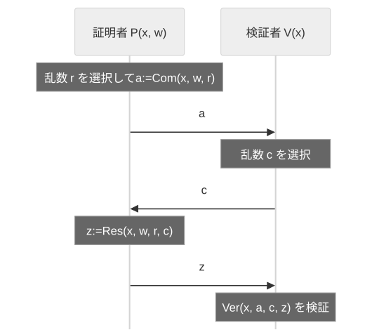

<!--
headingDivider: 1
-->
<!--
_class: title
-->
# ゼロ知識証明と $Σ$ プロトコル
 
光成滋生
 
last update: 2026/11/10

# 概要
## 目的
- $Σ$ プロトコルによるZKPの構成方法を理解する
- 群準同型の原像の知識証明として様々なZKPを統一的に扱う
- BBS署名の選択的開示証明と範囲証明の仕組みを理解する

## 用語一覧
- $Σ$ プロトコル, 特別な健全性, SHVZK, Fiat-Shamir変換
- Schnorr署名, OR-Proof, Lifted-ElGamal暗号
- 範囲証明, 選択的開示証明

# ZKP（復習）
## 用語
- 主張 (statement): $x$, 証拠 (witness): $w$
- 関係 (relation): $R$: $R(x,w)=1$ のとき $w$ は $x$ の正しさの証拠
- ZKP: 証明者 $𝒫$ が検証者 $𝒱$ に, ある主張 $x$ の正しさを *$w$ を教えずに*納得させる対話

## 求められる性質
- 完全性 (completeness): 主張が正しいなら $𝒱$ は（ほぼ）1の確率で受理する
- 健全性 (soundness): 正しくないならどんな $𝒫^*$ も $𝒱$ を騙せない
（無視できる確率でしか受理されない）
- ゼロ知識性 (zero-knowledge): $𝒱$ は主張が正しいこと以外の $w$ に関する新しい知識を得ない

# 詳しい定義
## NP (Nondeterministic Polynomial time) 言語
- $R$: 2変数決定的多項式時間アルゴリズム
- $L=\Set{x∈\Set{0,1}^* \mid ∃w∈\Set{0,1}^{p(|x|)}  \text{ s.t. } R(x,w)=1}$ をNP言語という
  - $x∈L$ を主張, $w$ を証拠という
  - $p(|x|)$ は $x$ の長さに関する多項式
## ゼロ知識性
- 任意のPPT検証者 $𝒱^*$ に対して、PPTシミュレータ $Sim(x, 1^{|x|})$ が存在し、
$x \in L$ のとき以下の二つの分布が計算量的識別不可能:

$$\{\mathsf{View}_{𝒱^*}[⟨𝒫(w), 𝒱^*⟩(x)]\}_{x \in L}
≈_c \{Sim(x, 1^{|x|})\}_{x \in L}$$

- $\mathsf{View}_{𝒱^*}$: $𝒱^*$ の視点（自身の乱数・受信メッセージのみ観測）
- $Sim$: $w$ を知らずに $x$ のみから実行記録(transcript)を模倣
- $≈_c$: 計算量的識別不可能（どんなPPT判別器も negligible な優位性しか持たない）

# キーワード
## 証明(proof)と議論(argument)
- 証明: 証明者の計算量について制限が無い
- 議論: 証明者の計算量が確率的多項式時間アルゴリズムに制限される
  - 証明・議論ともに検証者は常に多項式時間
## 証明(proof)と知識の証明(proof of knowledge)
- 証明: 主張 $x$ が正しいことを示す（$R(x,w)=1$ となる $w$ の存在を示す）
- 知識の証明: 証明者がその証拠 $w$ を知っていることを示す

# $Σ$ プロトコル
<!-- _class: image-right-center -->

## 証明者 𝒫 と検証者 𝒱 の(3-move)対話証明プロトコル
- 主張 $x$, 関係 $R(x,w)=1$, 証拠 $w$ について
𝒫 が $w$ を知っていることを $w$ を教えずに 𝒱 に証明する
1. Commit: 𝒫 は乱数 $r$ をとって $a:=Com(x,w,r)$
を 𝒱 に送る
2. Challenge: 𝒱 は乱数 $c$ をとって 𝒫 に送る
3. Response: 𝒫 は $z:=Res(x,w,r,c)$ を 𝒱 に送り
𝒱 は $Ver(x,a,c,z)$ で検証する

# $Σ$ プロトコルの要件
## 完全性
- $w$ を持つ 𝒫 が正しく実行すると 𝒱 は常に受理する

## 特別な健全性 (Special Soundness)
- 同じ $a$ に対する2個の受理transcript $(a, c_0, z_0)$, $(a, c_1, z_1)$ ($c_0 ≠ c_1$) から $w$ をPPT計算可能
  - 2個の異なるchallengeに正しく答えられるなら証拠 $w$ を抽出できる
  - この性質により「𝒫 は $w$ を知っている」ことを示せる
    - 知識の証明 (Proof of Knowledge)という

## 特別な正直検証者ゼロ知識 (SHVZK: Special honest Verifier ZK)
- $c$ を先に選んでから $(a, c, z)$ を生成するPPTシミュレータ $Sim$ で, その出力分布 $\Set{(a,c,z)}$ が
実際の受理transcriptの分布と計算量的に識別不可能なものが存在する（順序は気にしない）
  - ランダムに $c$ を選ぶ正直な検証者に対してはZK
  - 悪意ある検証者が $c$ を $a$ に応じて選ぶ場合は保証されない

# ECDLPの知識の証明
## 記号
- $G=⟨P⟩$: 素数位数 $q$ の加法巡回群, $K:=𝔽_q$, $s∈K$: 秘密鍵, $Q:=sP$: 公開鍵
## 「$Q=sP$ の $s$ を知っている」ことの $Σ$ プロトコル
1. Commit: $𝒫$ は乱数 $r∈K$ を選び $a:=r P$ を $𝒱$ に送る
2. Challenge: $𝒱$ は乱数 $c∈K$ を選び $𝒫$ に送る
3. Response: $𝒫$ は $z:=r + c s$ を $𝒱$ に送り, $𝒱$ は $z P \underset{?}{=} a + c Q$ を確認する
## 要件の確認
- 完全性: $zP=(r+cs)P=rP+c(sP)=a+cQ$
- 特別な健全性: $(a, c_i, z_i)$ ($c_0 ≠ c_1$) から $z_0 P - z_1 P=c_0 Q - c_1 Q$ より $s=\frac{z_0 - z_1}{c_0 - c_1}$
- SHVZK: $c, z∈K$ を選んで $a:=zP-cQ$ とすると $(a,c,z)$ は本物と同じ分布

# $Σ$ プロトコルの一般的な構成
## 群準同型の原像の知識証明（Maurer 2009）
- $K=𝔽_q$, $G$ を $K$ 上のベクトル空間, $φ:K^n→G$ を準同型写像とする
- 主張 $X∈G$, 証拠 $w∈K^n$, 関係 $R(X,w)=1 \iff φ(w)=X$
1. Commit: 𝒫 は $r∈K^n$ をとって $a:=φ(r)$ を 𝒱 に送る
2. Challenge: 𝒱 は $c∈K$ をとって 𝒫 に送る
3. Response: 𝒫 は $z:=r+c w∈K^n$ を 𝒱 に送り 𝒱 は $φ(z)\underset{?}{=}a+cX$ を確認する
- 完全性: $φ(z)=φ(r)+c φ(w)=a+c X$
## $φ$ の例
- ECDLPの知識の証明: $φ(w)=w P$, Pedersenコミットメント: $φ(w_1,w_2)=w_1 P+w_2 Q$
- Chaum-Pedersen: $φ(w)=(w P_1,w P_2)∈G:=G_1×G_2$
  - $G$ は位数 $q$ の加法巡回群 $G_i$ の直積なので $z$ を共有できる

# 一般的な構成の安全性
## 健全性（special soundness）
- 同じ $a$ に対する2個の $(a,c,z)$, $(a,c',z')$ ($c≠c'$) が受理されたら
  - $φ(z-z')=φ(z)-φ(z')=(a+cX)-(a+c'X)=(c-c')X$
  - $w:=(z-z')/(c-c')$ とすると $φ(w)=X$ と抽出できる
- $w$ を出力できない 𝒫* は各 $a$ につき高々1個の $c$ にしか答えられないので成功確率は $≦1/|K|$
## $φ$ の一方向性
- 健全性は $φ$ の一方向性を仮定せずに成り立つ
- しかし一方向性でないなら $X$ から $φ(w')=X$ となる $w'$ が求まり知識の証明の意味はない

## ゼロ知識性（special HVZK）
- $Sim(X,c)$: $z∈K^n$ をとって $a:=φ(z)-cX$ とすれば $(a,c,z)$ は本物と同じ分布
  - 本物も $z=r+cw$ は一様分布で $a$ は $z$ と $c$ から一意に決まる

# $Σ$ プロトコルをより強力な証明に変換する
## チャレンジ空間を大きくする
- 乱数をとる空間 $𝒞$ に対して健全性の誤り確率は $|𝒞|^{-1}$（一般的な構成では $𝒞=K$）
  - あるいはプロトコルを $k$ 回繰り返すと $|𝒞|^{-k}$ になる
## Fiat-Shamir変換
- $Σ$ プロトコルを非対話化する
  - チャレンジ $c$ をハッシュ関数 $H$ を用いて $c:=H(x,a)$ とする
1. 𝒫 は $r$ を選び $a:=Com(x,w,r)$, $c=H(x,a)$, $z:=Res(x,w,r,c)$ を計算し
証明 $π:=(a,z)$ を 𝒱 に送る
2. 𝒱 は $c=H(x,a)$ を計算して $Ver(x,a,c,z)$ をチェックする
- ランダムオラクルモデルの元で安全性が証明される
  - ハッシュ値は入力から一意に決まり, ユーザがコントロールできない乱数とみなせる

# Fiat-Shamir変換の安全性
## 一般的な構成の場合の短い証明
- 𝒫 は $c:=H(X,a)$ として $z$ を計算し、証明は $(c,z)$ だけ送る（ $a$ は送らない）
- 𝒱 は $a':=φ(z)-cX$ を求めて $c':=H(X,a')$ を計算し $c=c'$ を確認する
## ゼロ知識性（ランダムオラクルモデル）
- $c$ は $a$ を決めた後に $H$ で一意に決まるので 𝒫 は $c$ を選べない
  - $H$ をランダムオラクルとみなすと $Sim$ が $c$ を先に選んで $H(X,a):=c$
    と定義できるので special HVZK の $Sim$ がそのまま使える

## 健全性
- 𝒫* が $(c,z)$ を出せたら $H(X,a)$ の答えを $c'$ に差し替えて再実行し, 同じ $a$ に対する $(c',z')$ を得て special soundness で $w$ を抽出する（forking lemma）
- 𝒫* はハッシュを引くごとに $1/|K|$ で当てられるので成功確率は $Q_H/|K|$
（$Q_H$ は問い合わせ回数）

# Schnorr署名
## ECDLPの知識の証明の非対話化
- 証明: 乱数 $r$ を選び $a:=r P$, $c:=H(P,Q,a)$, $z=r+c s$ として $π:=(a,z)$ を送る
- 検証: $c=H(P,Q,a)$ を計算して $z P = a + c Q$ をチェック
## Schnorr署名
- メッセージ $m$ に対する署名: $c:=H(P,Q,a,m)$ として生成した証明 $(a,z)$ を署名 $σ$ とする
- 検証: $c=H(P,Q,a,m)$ を計算して $z P = a + c Q$ をチェック
  - $(c,z)$ を署名とする形式もある（$a':=zP-cQ$ を復元して $c=H(P,Q,a',m)$ を確認）
## 署名とZKPの関係
- 「秘密鍵を知っている」ことのZKPをメッセージに結びつけて非対話化したものが署名

# OR-Proof
## 2個の命題のどちらかが真であることを証明する
- $P_\text{or}:=\Set{(x_0,x_1,w) \mid R_0(x_0,w)=1 \text{ or } R_1(x_1,w)=1}$ を示したい
  - 𝒫は $R_b(x_b,w)=1$ （ $b$ は0か1のどちらか一方）のみを知っている
### Commit
- 知っている側は本当にやる: $r_b∈K$ を選び $a_b:=Com(x_b,w,r_b)$ を作る
- 知らない側は逆算する: $c_{1-b}∈K$ を選び $Sim(x_{1-b},c_{1-b})=(a_{1-b},z_{1-b})$ を作る
  - 𝒫 は $a:=(a_0,a_1)$ を 𝒱 に送る（$c_{1-b}$ と $z_{1-b}$ は覚えておく）
### Challenge
- 𝒱 は $c∈K$ を選び 𝒫 に送る
### Response
- 𝒫 は $c_b:=c-c_{1-b}$ として $z_b:=Res(x_b,w,r_b,c_b)$ を計算し $(c_0,c_1,z_0,z_1)$ を送る
- 𝒱 は $c_0+c_1\underset{?}{=}c$ を確認し、$Ver(x_i,a_i,c_i,z_i)$ を $i=0, 1$ について確認する

# Lifted-ElGamal暗号
## 記号
- $G=⟨P⟩$: 素数位数 $q$ の加法巡回群, $K:=𝔽_q$, $Q=m P$ のとき $DLP_P(Q):=m$
## 鍵生成
- $x∈K$: 秘密鍵, $x P$: 公開鍵
## 暗号化
- $ct:=Enc(m;r):=(S, T)=(m P + r x P, r P)$（$r∈K$ は乱数）
## 復号
- $Dec(ct):=S-xT$ として $m=DLP_P(Dec(ct))$
  - $Dec(Enc(m;r))=(m P+r xP) - x(rP)=mP$
  - $m$ が小さければ DLP を解いて $m$ が求まる

# 暗号文の平文の同値性のZKP
## 2種類のLifted-ElGamal暗号
- $G_i=⟨P_i⟩$($i=1, 2$): 同じ素数位数の加法巡回群, 鍵生成など添え字 $i$ が対応する
- $ct_i=(S_i,T_i)=Enc_i(m_i;r_i)$ があったとき $m_1=m_2$ であることをZKPで示したい
## Σプロトコルの構成
- 一般的な構成（群準同型の原像の知識証明）に当てはめる

# 平文の同値性のZKP: (ZkpEq)
## 準同型 $φ:K^3→{G_1}^2×{G_2}^2$ を作る
- 証拠 $w:=(m,r_1,r_2)$, 主張 $X:=(S_1,T_1,S_2,T_2)$
- $φ(m;r_1,r_2):=(Enc_1(m;r_1),Enc_2(m;r_2))$
  - $Enc_i(m;r)$ は $(m,r)$ について線形なので $φ$ は準同型
  - $m$ を2個の暗号文で共有した証拠とする
## 証明の生成
1. Commit: $r_m,r_p,r_s∈K$ をとって
$(R_1,R_2):=Enc_1(r_m;r_p)$, $(R_3,R_4):=Enc_2(r_m;r_s)$
2. Challenge: $c:=H(S_1,T_1,S_2,T_2,R_1,R_2,R_3,R_4)$
3. Response: $s_p:=r_p+c r_1$, $s_s:=r_s+ cr_2$, $s_m:=r_m+c m$
- 証明 $π:=(c,s_p,s_s,s_m)∈K^4$

# ZkpEq の検証
## $π=(c,s_p,s_s,s_m)$ からコミットメントを復元する
- (1): $R_1':=s_m P_1+s_p x_1 P_1-c S_1$, (2): $R_2':=s_p P_1-c T_1$
- (3): $R_3':=s_m P_2+s_sx_2P_2-cS_2$, (4): $R_4':=s_sP_2-cT_2$
- $c\underset{?}{=}H(S_1,T_1,S_2,T_2,R_1',R_2',R_3',R_4')$ を確認する
## 正しい証明なら $R_i'=R_i$
- $R_1'=(r_m+c m)P_1+(r_p+c r_1)x_1P_1-c(m P_1+r_1x_1P_1)=r_m P_1+r_p x_1 P_1=R_1$
- $R_2'=(r_p+c r_1)P_1-c r_1P_1=r_p P_1=R_2$（$R_3', R_4'$ も同様）
## 一般形との対応
- $a=(R_1,R_2,R_3,R_4)$, $z=(s_m,s_p,s_s)$, 検証式 $φ(z)=a+c X$
- $a=φ(z)-c X$ と書き直して $a$ を送らずに $c$ だけ送り 𝒱 に再計算させている
  - 群の元4個の代わりに $K$ の元1個で済む

# ZkpEq の安全性
## $m_1=m_2$ の証明（一般論を具体的に書き下したもの）
- 同じ $(R_1,…,R_4)$ に対する2個の受理 $(c,s_p,s_s,s_m)$, $(c',s_p',s_s',s_m')$ について
  - (2)から $R_2:=s_p P_1-c T_1=s_p' P_1-c' T_1$
    - よって $T_1=\frac{s_p-s_p'}{c-c'} P_1$ となり $r_1=\frac{s_p-s_p'}{c-c'}$
    - 同様に(4)から $r_2=\frac{s_s-s_s'}{c-c'}$
  - (1)から $R_1:=s_m P_1+s_p x_1 P_1-c S_1=s_m' P_1+s_p' x_1 P_1-c' S_1$
    - よって $\frac{s_m-s_m'}{c-c'} P_1 =S_1-\frac{s_p-s_p'}{c-c'} x_1 P_1=S_1- r_1 x_1 P_1$ から $m_1=\frac{s_m-s_m'}{c-c'}$
  - 同様に(3)から$m_2= (s_m − s_m')/(c − c')=m_1$
- 以上で証拠 $w=(m,r_1,r_2)$ が抽出できた

# 不正な 𝒫* が成功しない理由
## 再掲
- (1): $R_1':=s_m P_1+s_p x_1 P_1-c S_1$, (2): $R_2':=s_p P_1-c T_1$
- (3): $R_3':=s_m P_2+s_sx_2P_2-cS_2$, (4): $R_4':=s_sP_2-cT_2$
## 証明（一般論を具体的に書き下したもの）
- $R_2=r_pP_1$, $R_4=r_sP_2$ から $r_p, r_s$ が一意に決まる
- $R_1=r_{m,1}P_1+r_px_1P_1$, $R_3=r_{m,2}P_2+r_sx_2P_2$ で $r_{m,1}$, $r_{m,2}$ を決めると
  (1)(2)は $s_m=r_{m,1}+cm_1$, (3)(4)は $s_m=r_{m,2}+cm_2$ のときだけ成立
- 正直な 𝒫 は $m_1=m_2$, $r_{m,1}=r_{m,2}$ なので両者は同じ式になり, どんな $c$ でも成立する
- 不正な 𝒫*（$m_1≠m_2$）が1個の $s_m$ で両方を通せる $c$ は $c=\frac{r_{m,2}-r_{m,1}}{m_1-m_2}$ の1個だけ
  - $r_{m,1}, r_{m,2}$ は $R_1, R_3$ を送った時点で確定し
  $c=H(…)$ はその後に決まるので成功確率は $1/|K|$

# 範囲証明
## 0か1か（$ct=(S,T)=Enc(m;r)$ について $m∈\Set{0,1}$）
- $φ(r):=(r xP, rP)$ とすると $m=b \iff φ(r)=(S-bP,T)$（$b=0, 1$）
  - それぞれ $r$ の知識証明なので OR-Proof で「$m=0$ または $m=1$」を示す
- Pedersenコミットメント $C=sY_0+mY_1$ でも同様（$m=0 \iff C=sY_0$）
## $n$ が $b$ ビット（$n∈[0, 2^b-1]$）であること
- $n=Σ_{i=0}^{b-1} n_i 2^i$ と2進数展開し, 各 $ct_i:=Enc(n_i)$ について $n_i∈\Set{0,1}$ のZKPを作る
- $Enc(n)=Σ_{i=0}^{b-1} 2^i ct_i$ は準同型性により 𝒱 が自分で計算できる
## $n∈[a, b]$ であること
- $n':=n-a∈[0, b-a]$ とする. $c:=b-a$ を「2べき-1」の形に分割する
- たとえば $c=18$ なら $18=15+3$ として $n'_1∈[0,15]$, $n'_2∈[0,3]$, $n'=n'_1+n'_2$ のZKP

# BBS署名の概要
## 記号
- $e:G_1×G_2→G_T$: ペアリング, $G_i:=⟨P_i⟩$: 生成元, $Q_1, H_1, H_2, \dots∈G_1$: 固定点
- domain: 全ての公開パラメータの連結のハッシュ値
- $x$: 秘密鍵, $X:=x P_2$: 公開鍵
- $m_1, \dots, m_L$: メッセージ
- e: $x$, $m_1, \dots$, domainの連結のハッシュ値
- $B:=P_1+\text{domain} Q_1+\sum m_i H_i$ がメッセージ, $A:=\frac{1}{x+e}B$, $(A, e)$ が署名
  - 検証: $e(A, X + e P_2) = e(B, P_2)$
  -  ただし 𝒱 に対して $A$, $e$, $B$ は秘密
## 選択的開示証明
- $m_i$ のうち開示するものだけを選び, 非開示のメッセージに対するZKPを生成する
  - 開示する添え字の集合 $I$, 非開示の集合 $U$ とする（$I∪U=\Set{1,…,L}$）

# 選択的開示証明の構成（draft-irtf-cfrg-bbs-signatures-12）
## 署名のランダム化（提示ごとに $r_1, r_2∈K$ を選ぶ）
- $\bar{A}:=r_1 r_2 A$, $D:=r_2 B$, $\bar{B}:=r_1 D-e\bar{A}$, $r_3:=1/r_2$
  - $\bar{B}=r_1 r_2(B-eA)=r_1 r_2 xA=x\bar{A}$ なので $e(\bar{A},X)=e(\bar{B},P_2)$ が成り立つ
  - $\bar{A},\bar{B},D$ は毎回異なるので署名 $(A,e)$ や前回の提示と結びつかない (unlinkability)
## 示したい関係
- $B_v:=P_1+\text{domain} Q_1+\sum_{i∈I}m_iH_i$ は 𝒱 が開示情報から計算できる
- 証拠 $w:=(r_1,e,r_3,(m_j)_{j∈U})$, 主張 $(\bar{B},B_v)$ について
$φ(w):=(r_1D-e\bar{A},\ r_3D-\sum_{j∈U}m_jH_j)=(\bar{B},B_v)$
  - 第1式は $\bar{B}$ の定義, 第2式は $r_3D=B=B_v+\sum_{j∈U}m_jH_j$ より出る
  - $φ:K^{3+|U|}→{G_1}^2$ は $w$ について線形なので一般的な構成がそのまま使える

# 選択的開示証明の生成と検証
## 証明の生成（Fiat-Shamir）
1. Commit: $\tilde w:=(\tilde r_1,\tilde e,\tilde r_3,(\tilde m_j))$ をとって $(T_1,T_2):=φ(\tilde w)$
2. Challenge: $c:=H(\bar{A},\bar{B},D,T_1,T_2,(i,m_i)_{i∈I},\text{domain},\text{ph})$
    - ph: 提示ごとの付加情報（提示先や日時など）
3. Response: $z:=\tilde w+cw$
- 証明 $π:=(\bar{A},\bar{B},D,c,z)$: $G_1$ の元3個と $K$ の元 $4+|U|$ 個
  - draft では $\hat r_1:=\tilde r_1-cr_1$ など符号の取り方が異なるが同じもの
## 検証
- $(T_1',T_2'):=φ(z)-c(\bar{B},B_v)$ を計算し $c\underset{?}{=}H(\bar{A},\bar{B},D,T_1',T_2',…)$ を確認する
- $e(\bar{A},X)\underset{?}{=}e(\bar{B},P_2)$ を確認する

# 選択的開示証明の健全性のスケッチ
## 抽出した $w$ から署名を復元できる
- special soundness で $w$ を抽出すると $x\bar{A}=\bar{B}=r_1D-e\bar{A}$ から $(x+e)\bar{A}=r_1D=(r_1/r_3)B$
- $A':=(r_3/r_1)\bar{A}$ とおくと $(x+e)A'=B$: $(A',e)$ は $m_i$ ($i∈I$) と抽出した $m_j$ ($j∈U$) に対する正しい署名
  - つまり 𝒫 は開示情報と整合する署名を持っている
## ゼロ知識性
- $(\bar{A},\bar{B},D)$ は $r_1,r_2$ でランダム化され, $z$ は一般的な構成の $Sim$ でシミュレートできる
  - 非開示の $m_j$ も署名 $(A,e)$ も漏れない

# 範囲証明との結合
## 「BBS署名の非開示データ = 範囲証明の対象」をZKPで示す
- 非開示の $m_k$ の範囲証明は Pedersen コミットメント $C:=sY_0+m_kY_1$ に対して行う
  - $Y_0,Y_1∈G_1$: 固定点, $s∈K$: 提示ごとの乱数（$r_1,r_2$ とは独立）
- 問題: $C$ の中身が署名された $m_k$ と同じであることをどう示すか
  - $m_k$ は BBS 側では $H_k$ の係数, $C$ 側では $Y_1$ の係数で基底が違う（ZkpEq と同じ状況）
## 証拠を共有した1個の $φ$ にまとめる
- 証拠 $w':=(r_1,e,r_3,(m_j)_{j∈U},s)$, 主張 $(\bar{B},B_v,C)$ について
$φ'(w'):=(r_1D-e\bar{A},\ r_3D-\sum_{j∈U}m_jH_j,\ sY_0+m_kY_1)=(\bar{B},B_v,C)$
  - $w'$ について線形なので一般的な構成がそのまま使える（ZkpEq で $m$ を共有したのと同じ）
  - $m_k$ は第2成分と第3成分の両方に現れ, 同じ $\tilde m_k$, 同じ $c$, 同じ $\hat m_k=\tilde m_k+cm_k$ を使う
- special soundness で抽出した $w'$ は両式を満たすので $C$ の中身と署名中の $m_k$ は一致する

# 範囲証明との結合: 証明の形
## BBS 証明に追加されるデータ
- Commit: $\tilde s∈K$ を追加して $\tilde C:=\tilde sY_0+\tilde m_kY_1$ を計算する
- Response: $\hat s:=\tilde s+cs$ を追加する（$\hat m_k$ は BBS 証明のものをそのまま使う）
- 証明に増えるのは $C∈G_1$ と $\hat s∈K$ だけ. 𝒱 は $\tilde C':=\hat sY_0+\hat m_kY_1-cC$ を復元する
## チャレンジの共有（mcl の bbs.cpp での実装. draft 外の拡張）
- $C$, 述語, $\tilde C$, 範囲証明のコミットメントを拡張 presentation header ph' に詰め, ph' で draft-12 の ProofGen をそのまま実行する
  - $\text{ph}':=\text{"BBS\_EXT\_V1\_"}‖C‖\tilde C‖…‖\text{ph}$
  - $c=H(…,\text{ph}')$ が全体で1個になり, BBS 証明の生成・検証のコアは無変更で済む
- 範囲証明本体は $C_w:=C-\text{bound}\,Y_1$（中身 $w:=m_k-\text{bound}$, 乱数 $s$）に対して
ビット分解と OR-Proof で $0≦w<2^n$ を示す

# zk-SNARK
## Zero-Knowledge Succinct Non-interactive ARguments of Knowledge
- 非対話的で簡潔な知識の議論
- $Σ$ プロトコルによる証明の大きさは証拠の大きさに比例するが, zk-SNARKは証明が短く検証が速い
